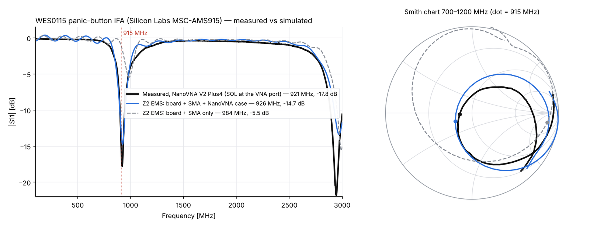
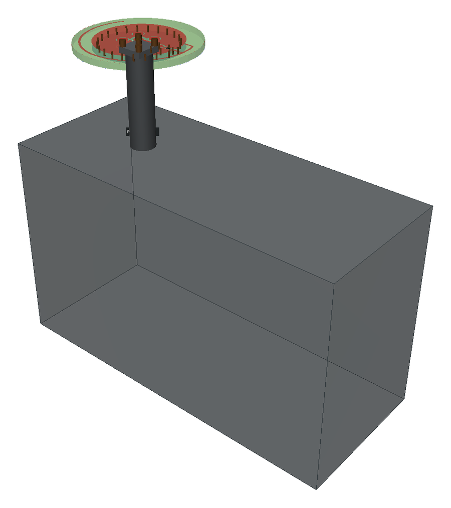
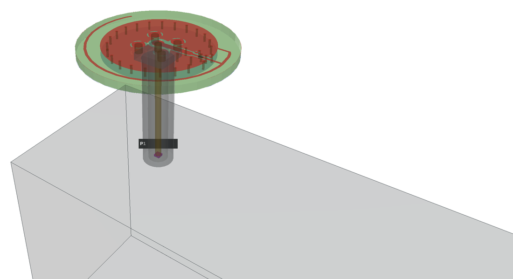
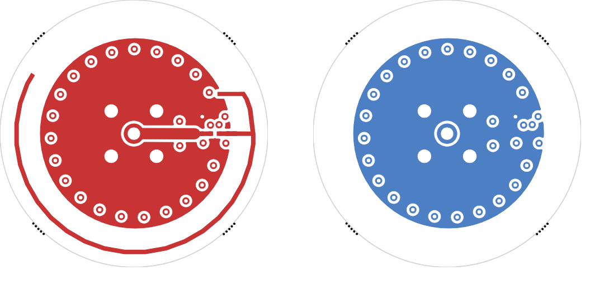

# Z2Labs EMS for KiCad

Electromagnetic simulation of KiCad boards from inside the PCB editor. The plugin
reads the board, its stackup and its connectors, sets up ports, runs the
[Z2 EMS engine](https://github.com/z2labs/z2ems) (an openEMS fork with a CUDA
engine, conformal metal edges and a KiCad importer) and brings the results back
onto the board: S-parameters, line impedance, the FDTD mesh, and the currents and
voltages of the run as maps and lines on the board and in a 3D viewer.

Status: **0.3.3.** Two-port lines, launches and small RF structures are routine;
large boards work but the run-time estimate tells you when a board is beyond
what a laptop CPU can do in reasonable time.

## What it does

The **Z2Labs EMS** button opens one window next to the PCB editor (KiCad stays
usable while it is open; it fits a laptop screen and scrolls when it has to, and
*keep on top* in its footer keeps it in front of the editor):

- **Ports.** A port is a **+** pad on the RF copper and a **-** reference to
  ground. Select a connector, an IC pin, or a pad and its ground pads in the PCB
  editor and click *+ Port from selection*: a connector gives its signal pad as +
  and all its ground pads as -, an IC pin its neighbouring GND pins, a pad with no
  ground copper next to it the ground plane below (a vertical port). *Set + / Set -
  here* changes one end, *Show* selects the port's pads in the editor. Connector
  suggestions are listed but used only when you tick and add them; a port without
  a reference is shown as incomplete and not simulated.
- **Markers.** Every port is drawn on a user layer (the first free one, e.g. `User.1`;
  the window names it): rings with
  + and -, arrows from each ground pad to the signal pad (or a down arrow and the
  reference layer name), and a "P1 50 Ω" label. A user layer has no copper and no
  nets, so DRC, ERC, the BOM and the fabrication outputs are unaffected.
- **Board.** Stackup check and *Fab stackup...* (JLCPCB 2-layer 1.6 mm,
  JLC04161H-7628, JLC081611-2116, your own JSON or an imported JLC table), ground
  nets.
- **Simulation.** Frequency range, loss models, run-size estimate, *Mesh preview* (the
  exact engine mesh on a user layer), *Simulate* (one excitation per ticked port),
  *Fields on board...*, *3D viewer*, *Clear overlays*. A run goes to the local
  engine server and continues in the
  background: the window shows its progress, opens the result and the 3D viewer
  when it is done, and picks the run up again when it is reopened.
- **Losses.** The stackup's εr and tan δ are always used. *laminate dispersion* adds
  the Djordjevic–Sarkar model (flat tan δ, causal εr(f); slower), *copper loss and
  roughness* gives the copper its finite conductivity and a surface roughness Rq
  (empty = from the stackup, about 2 µm for standard foil). Both off is the fast,
  lossless-conductor model the reference numbers below were made with; tick them when
  the insertion loss matters. *R, L, C parts* simulates two-pad passives with a value
  as lumped elements.

- **Fields.** Every run stores, for each driven port, the surface current on
  every copper layer, the E-field around the stack and the voltage of each copper
  layer against the next one, at 0.25, 0.5 and 0.9 x fmax, scaled to **1 W
  incident at the port** (a matched 50 Ω line carries 0.2 A and 10 V).
  *Fields on board...* draws them in the PCB editor: per copper layer a heat map
  (|Js| in dB, or the signed voltage) and **current lines** (width = current
  density, chevrons = direction) or **iso-voltage lines**, at the instant of the
  strongest field or a chosen phase, on its own user layer (`User.4`, `User.5`, ...). KiCad
  draws pictures under the copper, so the view then shows only that field layer,
  the board outline and the port markers; *Clear overlays* brings the other layers
  back. The
  *3D viewer* shows the same with arrows and lines, animated over the RF cycle,
  and a **cut plane** through the stack with the E-field lines from the trace to
  its reference plane.

Ports are saved in `<board>.z2ems/setup.json` next to the board. The 3D viewer
shows and simulates the same ports.

Two-pad R, L and C footprints become lumped elements in the model (value from the
footprint), so matching networks and series parts are simulated as placed.

## Validation against measurement

The engine is checked against our own VNA measurements of the Silicon Labs
MSC-AMS915 antenna matrix (915 MHz printed, chip and helical antennas on
2-layer FR4, SMA-fed). The boards are measured with a NanoVNA V2 Plus4 (SOL
calibration at the VNA port, the board on a straight SMA adapter, USB
connected) and simulated with the Z2 EMS engine the plugin uses. Boards are
added here once simulation and measurement agree; the rest of the matrix is
still being worked through.

### WES0115 – panic-button IFA (no matching network)



| | resonance | \|S11\| min |
|---|---|---|
| Measured (NanoVNA V2 Plus4) | 921 MHz | −17.8 dB |
| Simulated, board + SMA + NanoVNA case | 926 MHz (+0.5 %) | −14.7 dB |
| Simulated, board + SMA only | 984 MHz (+6.8 %) | −5.5 dB |

A small antenna on a VNA is not measured alone: the NanoVNA's metal case is
the other half of the antenna. Simulated without it, the IFA resonates 63 MHz
too high and is badly matched; with the case modelled as a 91 × 38 × 55 mm
metal box at the end of the 25 mm SMA jack + adapter, the resonance lands
within 5 MHz of the measurement, and the third-harmonic dip near 2.9 GHz
follows as well. When you validate an antenna this way, put the fixture in
the model.

<table>
<tr>
<td width="50%"></td>
<td width="50%"></td>
</tr>
<tr>
<td>The simulation model: the board on the SMA jack and adapter (a 25 mm
PTFE coax), on the NanoVNA case (metal box). The port is at the VNA end of
the coax.</td>
<td>The same, case made transparent: SMA body and PTFE, centre pin (gold) up
through the board, port P1 in the coax gap, the ring of ground vias and the
IFA arm on F.Cu (red).</td>
</tr>
<tr>
<td colspan="2"></td>
</tr>
<tr>
<td colspan="2">WES0115 copper as simulated: F.Cu (left) with the IFA arm round
the ground disc, B.Cu (right).</td>
</tr>
</table>

## Requirements

- KiCad **10** with *Preferences → Plugins → Enable KiCad API* ticked (KiCad offers
  to do this when the plugin is installed).
- The **Z2 EMS engine** (~160 MB, separate from the plugin). On Windows the plugin
  offers to download and install it the first time an action needs it (see below);
  on Linux and macOS it is built from source ([z2labs/z2ems](https://github.com/z2labs/z2ems#install)).
  An NVIDIA GPU is optional; with one, the CUDA engine is used when you choose the
  `cuda` or `auto` variant.
- Windows: the Microsoft Visual C++ 2015-2022 x64 runtime
  ([vc_redist.x64.exe](https://aka.ms/vs/17/release/vc_redist.x64.exe)). Most PCs have
  it. See *Troubleshooting* if the plugin buttons do not appear.

## Install

**From KiCad (Plugin and Content Manager):** *Tools → Plugin and Content Manager →
Plugins → Z2Labs EMS → Install*, then restart the PCB editor. KiCad creates the
plugin's Python environment itself.

**The engine:** the first time *Simulate* or *Mesh preview* needs it, or from the window's
*Engine...* button, the plugin shows what it would download (the latest
`Z2EMS_engine_*_win64.zip` from the [z2ems releases](https://github.com/z2labs/z2ems/releases),
its size and the target folder) and installs it only after you click *Download*. The file
is checked against the SHA-256 that GitHub publishes for it and unpacked to
`%LOCALAPPDATA%\Z2EMS\engine`; nothing else on the computer is changed. *Choose folder...*
points the plugin to an engine you already have (a source build on Linux/macOS, or a
zip you unpacked yourself). *Engine...* also updates the engine to a newer release; the engine server of
the old install is stopped first, and whenever the plugin finds a server of another or an older engine on
its port (a server keeps running after KiCad closes) it replaces it with one of the selected engine.

**From this repository (development):**

    powershell -ExecutionPolicy Bypass -File tools\install-windows.ps1     # Windows, KiCad closed
    tools/install-linux.sh                                                # or tools/install-macos.sh

The scripts link the repository into KiCad's plugin folder, enable the API server, add
the `z2ems` symbol and footprint library (`Z2EMS_PORT`, an explicit port footprint for
places without a connector) and run the unit tests. With the PCM install the library
files are in the plugin folder (`library/`); add them to the symbol and footprint
library tables by hand if you want the port footprint. `tools/build_pcm.py` builds the
PCM package.

Your own stackup presets (imported JLC tables, hand-made JSON) are kept in
`~/.z2ems/stackups`, outside the plugin folder, so an update does not remove them.

### Telling the plugin where the engine is

The engine package is found automatically in `%LOCALAPPDATA%\Z2EMS\engine`,
`C:\Z2EMS` or `~/z2ems` (Linux also `~/.local/share/z2ems/engine`). Anywhere else:

    set Z2EMS_ENGINE=D:\tools\z2ems-engine

or `~/.z2ems.json`:

```json
{ "engine": "D:/tools/z2ems-engine" }
```

(*Choose folder...* in the engine dialog writes this file.) Other keys / variables: `twin_py` / `Z2EMS_TWIN_PY` (Python with the CSXCAD and
openEMS bindings), `fork_root` / `Z2EMS_FORK_ROOT` (a z2ems source checkout),
`openems_exe` / `Z2EMS_OPENEMS` (engine executable), `Z2EMS_SERVER` (a running
engine server, default `http://127.0.0.1:8765`).

## Quick start

1. Download the example project
   [coupon_msl50.zip](https://github.com/z2labs/z2ems-kicad/raw/main/examples/coupon_msl50.zip)
   (a 40 mm 50 Ω microstrip with two SMA pads) and unpack it into a folder of its own.
   In KiCad: *File → Open Project* → `coupon_msl50.kicad_pro`, then open the PCB editor
   from the project window. (Do not open the board by double click while another KiCad
   window is running: KiCad then starts a second PCB editor that plugins cannot reach.)
2. **Fab stackup** → JLC04161H-7628 → Apply.
3. **Z2Labs EMS** → tick J1 and J2 under *Suggestions* → *Add ticked* (or select
   J1 in the editor → *+ Port from selection*, same for J2) → *Mesh preview*. On
   Windows the first action that needs the engine offers to download it (about
   160 MB, a minute or two) and then carries on.
4. **Simulate**. The run takes 5 to 15 minutes on a 4-core computer (the window
   shows the elapsed time, and its estimate uses this computer's measured speed from
   the second run on) and should report Z0 ≈ 49.5 Ω and εeff ≈ 3.35
   (`presets/refs/coupon_msl50.json`).
5. *Fields on board...* → P1, the middle frequency, surface current, F.Cu and
   In1.Cu: the signal current on the strip and its return current in the plane
   under it. In the *3D viewer*, *Fields* → *Show fields* → *Animate*, and *E-field
   on a cut plane* for the cross-section. *Clear overlays* removes everything the
   plugin drew.

## Troubleshooting

- **No Z2Labs EMS buttons in the PCB editor after the install (Windows), or a
  "VCRUNTIME140.dll was not found" message from `pythonw.exe`.** The Visual C++ runtime
  is missing, and KiCad has left a half-made Python environment for the plugin that it
  does not repair by itself. Install
  [vc_redist.x64.exe](https://aka.ms/vs/17/release/vc_redist.x64.exe), close KiCad,
  delete the folder
  `%LOCALAPPDATA%\KiCad\10.0\python-environments\com.github.z2labs.z2ems` and start
  KiCad again: it rebuilds the environment (a minute, needs the internet) and the
  buttons appear.
- **"This PCB editor cannot be reached by the plugin" / "kicad_token did not match" /
  "Connection refused".** The PCB editor was started while another KiCad window was
  open (a board opened by double click, a second KiCad). Only the KiCad that was started
  first talks to plugins. Close all KiCad windows, open the project in KiCad and start
  the PCB editor from the project window.
  After a plugin update from the Plugin and Content Manager, close that window with
  *Close* and make sure no KiCad is left running without a window (Task Manager,
  `kicad.exe`) before starting KiCad again.
- **No buttons, no message.** Check *Preferences → Plugins → Enable KiCad API*, then
  restart KiCad. The same folder can be deleted to make KiCad set the plugin up again.
- **The engine server.** Simulations run in a small local server
  (`http://127.0.0.1:8765`, this computer only) that keeps running after KiCad closes so
  that a long run can finish. Its log is in `%LOCALAPPDATA%\Z2EMS\logs` (Linux:
  `~/.local/state/z2ems`).

## Layout

```
plugin.json          KiCad plugin manifest (actions and toolbar buttons)
z2ems/               plugin package (ipc, model, stackup, ports, mesh preview, simulate, overlays, ui)
library/             z2ems symbol + Z2EMS_PORT footprint
presets/stackups/    fab stackup presets (JSON)
presets/refs/        reference results used by the result dialog
spike0/              KiCad API capability check for developers (run from a source checkout; not in the PCM package)
tests/               pytest, no KiCad needed
tools/               installers, PCM package builder (build_pcm.py), headless KiCad helper
pcm/                 PCM metadata template and 64x64 icon
docs/DESIGN.md       design notes: data model, port and ground rules, overlays, roadmap
```

## Known limitations

- KiCad 10.0.x cannot write the board stackup through the API; the stackup
  preset is applied by saving, patching and reloading the board file (the plugin
  asks first and keeps a backup).
- Through-hole connectors without reference copper under the pad get their port
  moved along the track to the first point with copper below it; for anything
  else place a `Z2EMS_PORT` footprint.
- Very large boards (hundreds of millions of cells) need a GPU or a crop of the
  region of interest.

## Tests

    pip install -r requirements.txt pytest
    pytest tests

## License

GPL-3.0-or-later, see [LICENSE](LICENSE). The engine is GPL-3.0 (openEMS) and
LGPL-3.0 (CSXCAD), © Thorsten Liebig and contributors, with the Z2 EMS additions.
